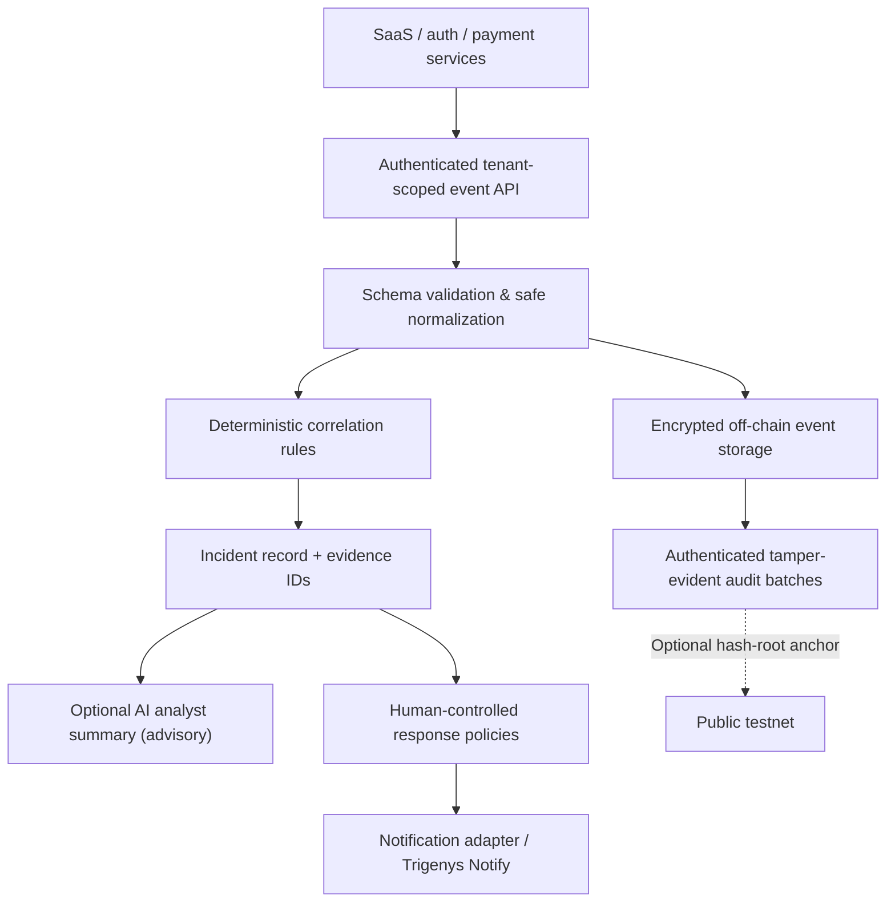

# Trigenys Aegis

> **A suspicious event is a signal. A correlated sequence is an incident.**
>
> A policy-first security monitoring platform for independent SaaS teams, designed to convert distributed application events into explainable incidents and independently verifiable evidence.

**Status: design / bootstrap only.** The repository currently contains an AppFactory-generated TypeScript API scaffold; threat detection, alerting and tamper-evident auditing have not shipped. No production SOC or security certification is claimed.

[Architecture](#security-architecture) · [Detection](#proposed-detection-workflows) · [Roadmap](#delivery-roadmap) · [Threat model](docs/THREAT_MODEL.md) · [Issues](../../issues)

## The problem

A small business might host authentication, payments, inventory and notification services separately. Each system produces local logs, but an attacker exploits the **sequence** between them: repeated login failures, a suspicious success, a privilege escalation and then a payment destination change. Those events may look harmless when reviewed in isolation.

Aegis is designed to normalize those signals across services, apply deterministic correlation rules and explain the risk with precise source evidence. Its long-term ambition is practical security visibility for lean product teams, **not** a promise to replace a staffed SOC.

## An incident worth catching

At 02:13, a tenant's admin account fails authentication 27 times; at 02:18, a login from a new client succeeds. A new payout beneficiary is then added. Aegis should generate a correlated incident with each supporting event, a reason for severity, and an explicit recommended response.

The system **must not autonomously disable customer accounts or change payout configurations by default**. The application owner decides which controls may require confirmation or be automated.

## Why Aegis is different

- **Correlation before generative explanation:** every finding originates from authenticated event evidence and explicit detection policies, not a free-form model suspicion.
- **Multi-tenant isolation:** tenant identity is established at ingestion, not trusted from an arbitrary event field.
- **Verifiable audit boundaries:** raw data stays protected off-chain; batched fingerprints can be verified externally without leaking customer content.
- **Actionable, explainable alerts:** trace a detection to source events, rule versions, time windows, and proposed remediation.
- **Built for small SaaS operations:** lightweight integration and resource-conscious design precede advanced automation.

## Security architecture



**Trust boundaries:** application credentials are scoped per tenant and source; the intake endpoint authenticates the source before assigning tenant identity; only whitelisted event fields reach the detection engine; secrets and raw logs never go to public chains. AI output never overrides authorization or triggers a sensitive action by itself.

The first architecture uses AppFactory's **TypeScript API service** to own ingestion contracts, authentication and deterministic correlation. A future Python analytical service may be attached through explicit, authenticated contracts; no Python service has been deployed.

## Proposed detection workflows

1. **Authentication abuse:** repeated failures → successful access → new session/privilege.
2. **Sensitive configuration change:** beneficiary/payout change following elevated-risk sign-in.
3. **Privilege escalation:** role change followed by sensitive access outside the ordinary sequence.
4. **Event integrity anomaly:** invalid producer signature, replayed event ID or tampered evidence.
5. **Tenant-boundary violation:** source identity attempts to submit or query another tenant's records.

Each rule will have controlled fixtures, false-positive considerations, timestamps and evidence references. A model-generated summary is a *triage aid*, not a guaranteed detection or forensic conclusion.

## Delivery roadmap

- **Foundation:** tenant-aware source authentication, strict schemas, threat model and reproducible CI.
- **MVP:** ingest and store redacted events; ship five deterministic detection fixtures.
- **Response:** incident view, safe acknowledgments and Trigenys Notify alerts.
- **Assurance:** tamper-evident evidence verifier, retention policy and security regression tests.
- **Optional extensions:** evidence-backed AI triage and batch fingerprint anchoring on an EVM testnet.

## Industry references

The design is informed by [NIST Cybersecurity Framework 2.0](https://www.nist.gov/cyberframework), [OWASP API Security Top 10](https://owasp.org/API-Security/editions/2023/en/0x11-t10/), and [MITRE ATT&CK](https://attack.mitre.org/). These are **references for design and evaluation**, not claims of certification or audited alignment.

## Known limitations

Aegis is at the design stage. It does not yet ship a security event collection pipeline, a functioning correlator, production monitoring, an AI analyst or blockchain proof issuance. It cannot guarantee prevention or detection of all attacks and cannot prove the original truthfulness of submitted logs.

## Engineering foundation

The repository was provisioned using the **generic TypeScript API preset of [Trigenys AppFactory](https://github.com/Trigenys/appfactory)**. That preset supplies a minimal HTTP API, tests, CI and [AppFactory Project Automation](https://github.com/EagleFox31/appfactory-project-automation), but does not silently provision hosting, billing or databases.

To run the bootstrap service locally:

```bash
npm install
npm run check
npm run dev
```

The current bootstrap `GET /health` is not proof of security feature readiness. Development follows the [RAIDER Engineering Standard](https://github.com/EagleFox31/project-registry/blob/main/RAIDER.md), with versioned contracts and a documented threat model.

---

**Trigenys Aegis** · *See the sequence. Verify the evidence.*
